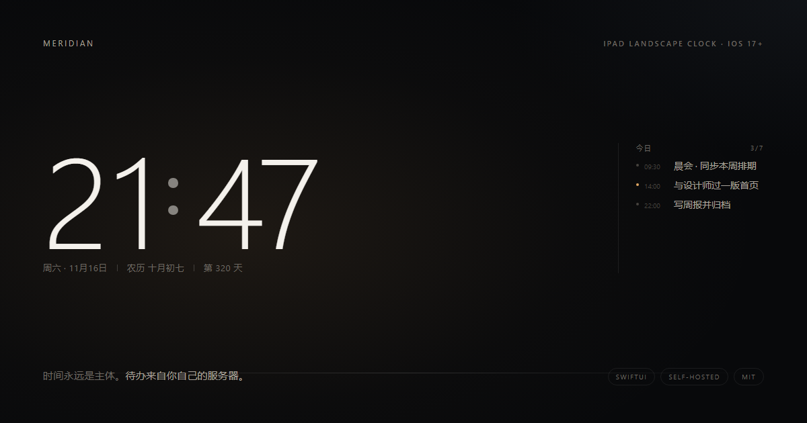
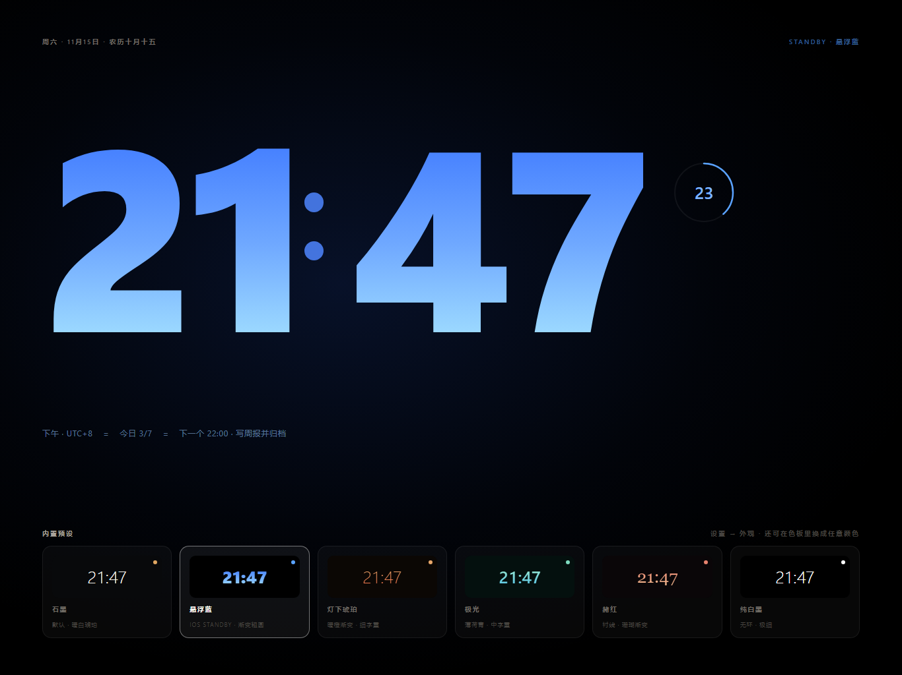
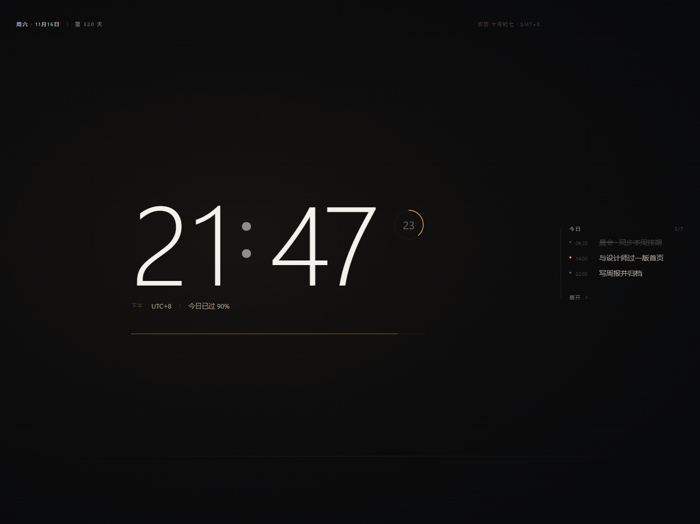

# Meridian

> An iPad clock for the wall — landscape, always-on, almost nothing on screen but the time.

SwiftUI · iOS 17+ · **zero third-party dependencies** · tasks come from *your own* server.



[中文](README.md) · English

---

## What it is

Meridian is not another clock app. It is a **self-hosted desk instrument**:

- **The time is the subject.** Huge numerals that scale with the glass; the date, lunar calendar, seconds ring and day-progress line are annotations, not features;
- **The agenda comes from your server** — a single-file, dependency-free Node service. No subscription, no cloud account, your data stays with you;
- **Push from your phone** — the server ships a static page; open it on a phone and send a task to the iPad;
- **Leave it for a week** — screen stays awake, anti-burn-in drift, night dimming, offline cache, automatic reconnect.

For people who have a spare iPad and don't want "what to do today" scattered across three apps.

---

## Features

| Area | What you get |
| --- | --- |
| Clock stage | Three layouts (stacked / inline / minimal), 12/24 h, seconds digits + ring, Chinese date + lunar, day-progress rule |
| Agenda | Today's list, completion, priority, quick add, move-to-tomorrow, context menu delete |
| Sync | Bearer auth, snapshot pull, **SSE live**, polling fallback, offline outbox replay, `updatedAt` last-write-wins |
| Push page | Phone-friendly static page, six channels, token in `localStorage` |
| Immersive | Collapsing the panel leaves a three-line "glance" strip; tap it for a focused card, tap the clock to step back |
| Due reminders | Small window + continuous irregular jitter + sustained haptics — **never dismisses itself** |
| Focus / World clock | 25/45/90-minute timer; four cities with day/night |
| Appearance | 6 skins with live hue sliders; 6 backgrounds with intensity and hue shift, all previewed live |
| Ambient light | Screen-backlight by default (free); optional camera probes every 30 s |
| Burn-in | 1 pt drift every 30 min, with a demo mode so you can see it working |
| Updates | In-app version check → one-tap install link; AltStore source manifest included |

### Skins



### Immersive glance



---

## Quick start

### A. iPad + any machine that runs Node (recommended)

```bash
cd server
MERIDIAN_TOKEN="$(openssl rand -hex 24)" node meridian-server.mjs
# listens on 0.0.0.0:8787, data in server/data.json
```

Install the app on the iPad (below), then in **Settings → Server**:

```
Address: http://<your-host>:8787
Token:   the MERIDIAN_TOKEN above
```

### B. With a Mac

```bash
brew install xcodegen
xcodegen generate
open Meridian.xcodeproj
```

### C. Without a Mac

Push to GitHub and let Actions build it — that's how this project ships:

```bash
node Tools/publish-to-github.mjs     # needs GITHUB_TOKEN with repo + workflow
# or just `git push` and run the "Build IPA" workflow
```

The output is an **unsigned IPA**.

### Installing the unsigned IPA

| Tool | Notes |
| --- | --- |
| **TrollStore** | Drag in, permanent, overwrite keeps app data |
| **AltStore / SideStore** | Signed with your Apple ID; free accounts re-sign every 7 days; add the source to auto-update |
| **Sideloadly** | Windows, USB install |

### Optional: portal + push page

`deploy/` contains a static portal, the push page, and an installer:

```bash
sudo bash deploy/install.sh
# lays down the static site, installs the systemd unit, generates the token
# it does NOT touch your nginx — copy deploy/nginx-meridian.conf.example instead
```

See [docs/DEPLOY.md](docs/DEPLOY.md).

---

## Architecture

```
┌──────────────────────┐        Bearer / JSON / SSE         ┌─────────────────────┐
│  iPad app (SwiftUI)  │ ─────────────────────────────────▶ │  Node task server    │
│  ClockStage          │ ◀───────────────────────────────── │  127.0.0.1:8787      │
│  AgendaPanel         │      snapshot / task / delete      │  data.json (atomic)  │
│  SyncEngine          │                                    └──────────┬──────────┘
│  LightSensor         │                                    ┌──────────┴──────────┐
└──────────────────────┘                                    │  nginx (optional)   │
                                                            │  /meridian/  portal │
                                                            │  /meridian/api/     │
                                                            └─────────────────────┘
```

- **App layers**: `Core` (models/store/skin/sensors), `Clock`, `Agenda`, `Sync`, `Settings`, `Design`;
- **Render budget**: the big numerals repaint once a minute; only the two seconds glyphs repaint at 1 Hz; burn-in drift runs every 30 min;
- **Sync**: poll + SSE in parallel, local writes go through an outbox, merges are `updatedAt` last-write-wins.

Details: [docs/ARCHITECTURE.md](docs/ARCHITECTURE.md).

---

## Docs

| Doc | Contents |
| --- | --- |
| [docs/BUILD.md](docs/BUILD.md) | XcodeGen, building, signing, sideloading, Actions permissions, common errors |
| [docs/DEPLOY.md](docs/DEPLOY.md) | Server deployment: LAN, systemd, pm2, Docker, HTTPS reverse proxy |
| [docs/API.md](docs/API.md) | HTTP contract: endpoints, fields, error codes, SSE frames, idempotency |
| [docs/PUSH-PAGE.md](docs/PUSH-PAGE.md) | Push page: channels, parameters, customising, security |
| [docs/UPDATE.md](docs/UPDATE.md) | Update model: why iOS can't self-update, three layers, version semantics |
| [docs/PRIVACY.md](docs/PRIVACY.md) | Privacy: what is collected, what is not, camera use, data locations |
| [docs/ARCHITECTURE.md](docs/ARCHITECTURE.md) | Layers, state machine, render budget, the three side-pipelines |
| [docs/DESIGN.md](docs/DESIGN.md) | Design system: colour, type, spacing, motion, what is forbidden |

(docs are in Chinese; the code comments are in English.)

---

## Privacy

In one line: **the app only talks to the server you configure, collects nothing, and has no account system.**

- Tasks live in local Application Support and on your server;
- The camera is used *only* when you enable "precise ambient light": it reads average frame luma and never stores, uploads, or records a frame;
- The default ambient mode reads the screen backlight and never touches the camera.

See [docs/PRIVACY.md](docs/PRIVACY.md).

---

## FAQ

**Why iOS 17?** Uses `onKeyPress`, newer `Slider` behaviour and two-parameter `onChange`. Dropping to 16 touches a handful of APIs in `Settings` and `Agenda`.

**iCloud sync?** No, by design — data stays with you. Adding CloudKit would need a master/replica decision against the server.

**Why no `.xcodeproj` in the repo?** The project is generated from `project.yml` by XcodeGen. A committed pbxproj drifts from sources and turns every merge into an XML conflict.

**Can the app update itself?** iOS forbids replacing your own binary. The app can only notice a newer build and hand you an install link — see [docs/UPDATE.md](docs/UPDATE.md).

**Will tasks be lost?** Local writes enter an outbox before sending; offline keeps them queued. The server writes `data.json` via temp file + rename.

---

## License

[MIT](LICENSE).
