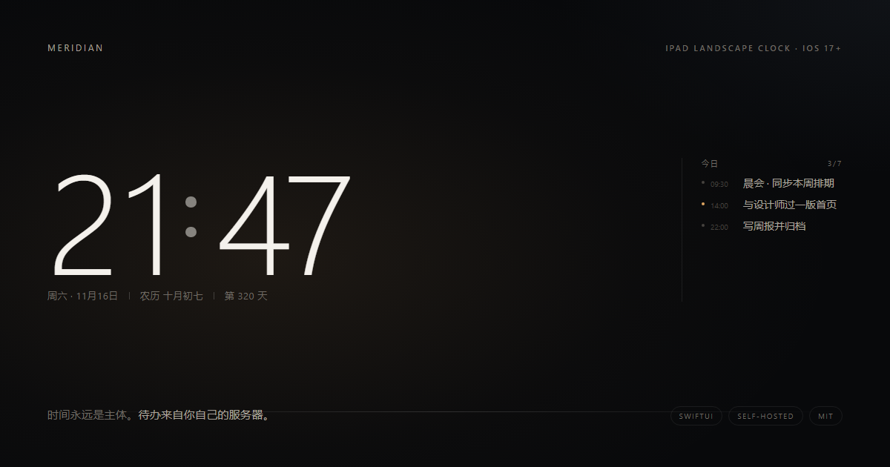
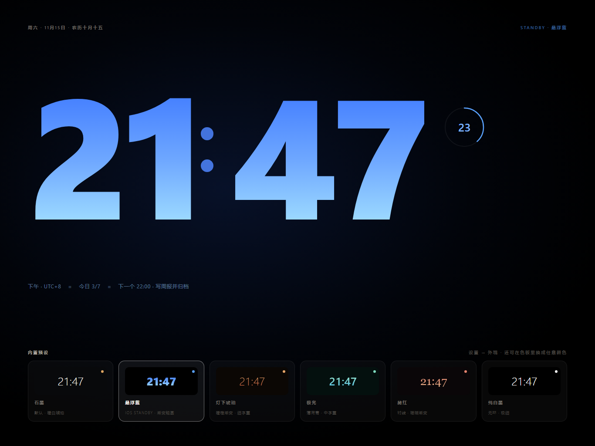
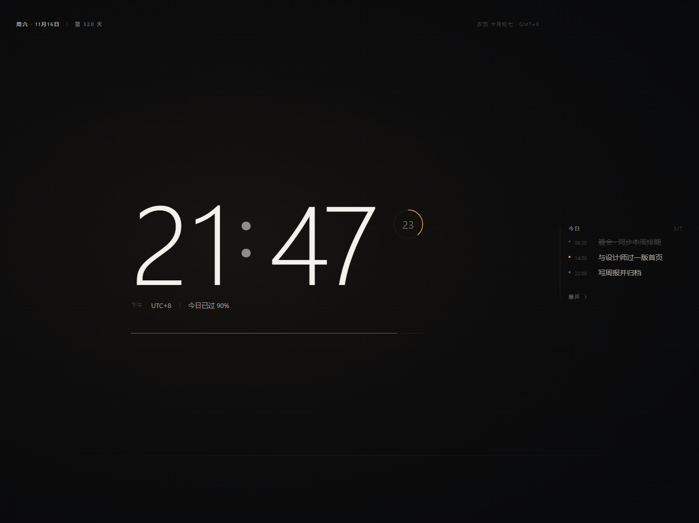
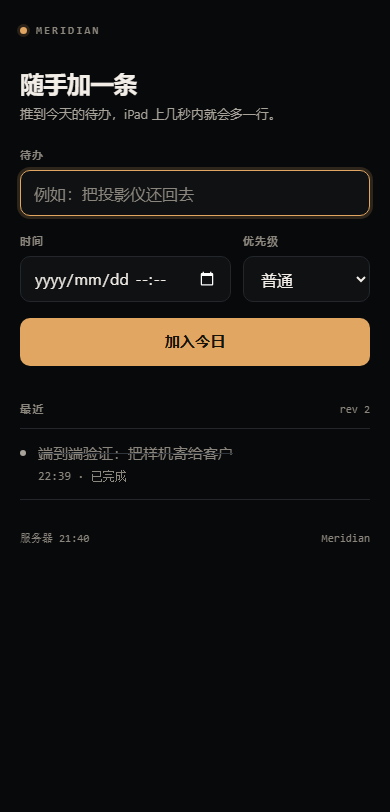

# Meridian · 子午

> 一台放在桌上的 iPad 时计。横屏常亮，几乎全屏只有时间，右边一列卡片装着今天、专注和世界时钟。

SwiftUI · iOS 17+ · **零第三方依赖** · 待办由你自己的服务器下发。



中文 · [English](README.en.md)

---

## 这是什么

Meridian 不是又一个"时钟 App"，而是一个 **可自托管的桌面时计**：

- **时间永远是主体**：巨大的数字，字号随窗口自适应，其余一切（日期、农历、秒环、进度线）都是它的注释；
- **待办来自你的服务器**：不是订阅制云同步，而是一个你自己的 Node 服务（零依赖，单文件），数据在你手里；
- **手机也能推**：服务器自带一个静态下发页，手机打开就能给 iPad 推一条待办；
- **放一周不用管**：屏幕常亮、防烧屏微位移、夜间调光、离线缓存、断网自动重连。

它适合：把旧 iPad 挂在墙上/桌上当钟，又不想让"今天要做什么"散落在三个 App 里的人。

---

## 功能

| 模块 | 说明 |
| --- | --- |
| 时间舞台 | 三种布局（层叠 / 并排 / 极简）、12/24 小时、秒数字 + 秒环、中文日期 + 农历、当日进度线 |
| 待办 | 今日列表、勾选完成、优先级、快速添加、拖去明天、上下文菜单删除 |
| 同步 | Bearer 鉴权、快照拉取、**SSE 实时**、轮询兜底、离线队列回放、`updatedAt` last-write-wins |
| 下发页 | 手机浏览器打开，六个通道（日常/工作/学习/生活/提醒/临时），填口令即可推 |
| 沉浸模式 | 收起面板后右侧留一条"窥视条"（3 条待办）；点它进入聚焦卡片，点时钟逐级退回 |
| 到期提醒 | 小窗口浮出 + 持续轻微抖动 + 手机持续震动，**不点不消失** |
| 专注 / 世界时钟 | 25/45/90 分钟倒计时；四城市时间与昼夜 |
| 外观 | 6 套皮肤 + 色相滑块实时预览；6 种背景 + 强度/色相偏移，全部实时可见 |
| 环境光 | 默认跟随屏幕亮度（零功耗）；可选摄像头 30 秒脉冲测光（更准，略费电） |
| 防烧屏 | 每 30 分钟整体平移 1pt；带"演示模式"（8pt/2s）让你确认它在动 |
| 在线更新 | App 内检查版本 → 一键打开安装链接；另带 AltStore 源描述文件 |

### 外观预设



### 沉浸态（右侧窥视条）



### 手机下发页



---

## 快速开始

### 路线 A：有 iPad + 一台能跑 Node 的机器（推荐）

```bash
# 1. 起服务器（零依赖，Node 18+）
cd server
MERIDIAN_TOKEN="$(openssl rand -hex 24)" node meridian-server.mjs
# 默认监听 0.0.0.0:8787，数据写 server/data.json

# 2. 把 App 装到 iPad（见下方"安装"）

# 3. iPad 里填
#    服务器地址：http://<你的机器 IP>:8787
#    口令：刚才那个 MERIDIAN_TOKEN
```

### 路线 B：有 Mac

```bash
brew install xcodegen
xcodegen generate
open Meridian.xcodeproj   # 选 iPad 真机/模拟器运行
```

### 路线 C：没有 Mac

推到 GitHub，让 Actions 的 macOS runner 出包（本项目就是这么构建的）：

```bash
node Tools/publish-to-github.mjs        # 需要 GITHUB_TOKEN（repo + workflow 权限）
# 或者直接 git push，然后在 Actions 里点 "Build IPA"
```

产物是 **未签名 IPA**，需要用下面任一方式安装。

### 安装（未签名 IPA）

| 方式 | 适用 | 说明 |
| --- | --- | --- |
| **TrollStore** | 支持 TrollStore 的 iOS 版本 | 拖入 IPA 即装，永久有效，覆盖安装保留数据 |
| **AltStore / SideStore** | 通用 | 用自己的 Apple ID 签名，免费账号 7 天续签；配好源可一键更新 |
| **Sideloadly** | Windows | 数据线连接，拖入 IPA，填 Apple ID |

> 免费开发者账号签名的 App 7 天过期，需重新签；TrollStore 与付费账号不受此限。

### 带门户部署（可选，但推荐）

`deploy/` 里有一套静态门户 + 下发页 + 一键安装脚本：

```bash
sudo bash deploy/install.sh
# 它只做三件事：铺静态站点、装 systemd 服务、生成口令
# 不会碰你的 nginx —— 把 deploy/nginx-meridian.conf.example 抄进你自己的配置
```

详见 [docs/DEPLOY.md](docs/DEPLOY.md)。

---

## 架构

```
┌──────────────────────┐         Bearer / JSON / SSE         ┌─────────────────────┐
│  iPad App (SwiftUI)  │ ──────────────────────────────────▶ │  Node 任务服务       │
│                      │ ◀────────────────────────────────── │  127.0.0.1:8787      │
│  ClockStage          │        snapshot / task / delete     │  data.json（原子写） │
│  AgendaPanel         │                                     └──────────┬──────────┘
│  SyncEngine          │                                                │
│  LightSensor         │                                     ┌──────────┴──────────┐
└──────────────────────┘                                     │  nginx / 门户 / 下发页 │
                                                             │  /meridian/           │
                                                             │  /meridian/push/      │
                                                             └───────────────────────┘
```

- **App**：`Core`（模型/存储/皮肤/传感器）、`Clock`（舞台）、`Agenda`（面板/提醒）、`Sync`（网络）、`Settings`、`Design`；
- **服务器**：单文件零依赖 Node，JSON 持久化，SSE 广播；
- **同步**：前台轮询 + SSE 双通道；本地写先入 outbox，按 `updatedAt` 合并，离线不丢；
- **刷新率分层**：大数字每分钟、秒环/秒数字每秒（独立 TimelineView）、防烧屏每 30 分钟。

更多见 [docs/ARCHITECTURE.md](docs/ARCHITECTURE.md)。

---

## 文档

| 文档 | 内容 |
| --- | --- |
| [docs/BUILD.md](docs/BUILD.md) | XcodeGen、构建、签名、侧载、Actions 权限、常见报错 |
| [docs/DEPLOY.md](docs/DEPLOY.md) | 服务器部署：局域网 / systemd / pm2 / Docker / HTTPS 反代 |
| [docs/API.md](docs/API.md) | 服务器 HTTP 契约：端点、字段、错误码、SSE 帧、幂等语义 |
| [docs/PUSH-PAGE.md](docs/PUSH-PAGE.md) | 下发页：通道、参数、自定义、安全 |
| [docs/UPDATE.md](docs/UPDATE.md) | 更新机制：为什么不能自更新、三层方案、版本号语义 |
| [docs/PRIVACY.md](docs/PRIVACY.md) | 隐私：收集什么、不收集什么、相机怎么用、数据在哪 |
| [docs/ARCHITECTURE.md](docs/ARCHITECTURE.md) | 分层、状态机、刷新率、三条支线 |
| [docs/DESIGN.md](docs/DESIGN.md) | 设计规范：色彩/字体/间距/动效/禁区 |

---

## 隐私

一句话：**App 只连你自己填的服务器，不采集任何统计数据，不上报崩溃，没有账号体系。**

- 待办在本地 Application Support + 你自己的服务器；
- 相机仅在开启「环境光自适应 → 精确测光」时使用，只读画面平均亮度，**不保存、不上传、不出帧**；
- 默认环境光模式只用屏幕背光，完全不碰相机。

完整说明见 [docs/PRIVACY.md](docs/PRIVACY.md)。

---

## 目录结构

```
ios/Meridian/             SwiftUI 工程
  App/                   入口、RootView、面板条、状态条
  Clock/                 时钟舞台、秒环、日期、背景、专注/世界时钟
  Agenda/                今日/接下来/服务器面板、提醒、窥视条
  Core/                  模型、存储、皮肤、背景、传感器、诊断、更新检查
  Sync/                  同步引擎、SSE、编解码、证书信任
  Settings/              设置页（外观/背景/显示/服务器/关于）
  Design/                Theme（设计 token）与基础组件
  Assets.xcassets/       图标与颜色
server/                  零依赖 Node 任务服务 + 测试
deploy/                  门户、下发页、安装脚本、nginx 示例
docs/                    文档
Tools/                   图标生成、静态检查、无 git 发布脚本
design/                  设计稿（可交互 HTML）与渲染截图
.github/workflows/       macOS 构建 → 未签名 IPA
```

---

## 常见问题

**Q：为什么最低 iOS 17？**
A：`Observation` 之外，主要用了 iOS 17 的 `onKeyPress`、`Slider` 新行为与两参 `onChange`。降到 16 需要替换少量 API，改动集中在 `Settings` 与 `Agenda`。

**Q：能用 iCloud 同步吗？**
A：目前不。设计前提是"数据在你自己手里"，同步走自建服务器。要做 iCloud 可以加一层 `NSUbiquitousKeyValueStore` 或 CloudKit，但与服务器同步会冲突，需要先定主从。

**Q：为什么 `xcodeproj` 不在仓库里？**
A：工程由 XcodeGen 从 `project.yml` 生成。git 里放一个几千行的 pbxproj 只会在合并时打架，而且容易和源码漂移。

**Q：App 里能自动更新吗？**
A：iOS 不允许 App 替换自身二进制。App 能做的是"知道有新版本 + 给你安装链接"，见 [docs/UPDATE.md](docs/UPDATE.md)。

**Q：待办会不会丢？**
A：本地写先入 outbox 再发；离线时留在队列，恢复后按顺序回放。服务器 `data.json` 用临时文件 + rename 原子写。

---

## 许可

[MIT](LICENSE)。图标、字体（系统字体）与截图可随项目一起分发；`design/` 下的设计稿同样是 MIT。
